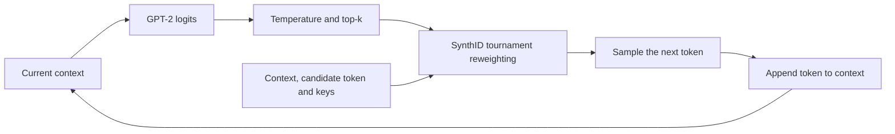
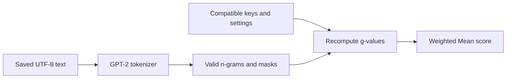

# Slide 5: generation and detection

## Slide objective

Connect the explanation to the code that already runs. Show a generation flow, a shorter detection flow, and a small real code excerpt. Do not put an entire source file on the slide.

## Generation flow



This is a conceptual flow of the local reference implementation. It is not a claim that ChatGPT or every Claude model runs this exact code.

The local configuration uses n-gram length 5: four context tokens plus the candidate token. The public demonstration key file has 30 integers, corresponding to 30 watermarking layers. The processor computes binary g-values from n-grams and keys, then applies tournament-based score updates. It avoids applying the same marking context repeatedly.

The model samples from the adjusted distribution. The most probable token is not guaranteed to be selected. Once a token changes, later model contexts can also change.

## Real source locations

| File/function | Role |
| --- | --- |
| `scripts/prompt_demo.py: load_keys` | Read and validate the external configuration. |
| `ConfiguredSynthIDGPT2LMHeadModel._construct_warper_list` | Give the model its caller-specific SynthID processor. |
| `src/synthid_text/logits_processing.py: watermarked_call` | Compute g-values and update candidate scores. |
| `src/synthid_text/logits_processing.py: update_scores` | Apply the default tournament update. |
| `scripts/prompt_demo.py: score_tokens` | Prepare detection inputs and masks. |
| `src/synthid_text/detector_mean.py: weighted_mean_score` | Calculate the official Weighted Mean score. |

For a short code excerpt, highlight the existing call:

```python
updated_scores = update_scores(scores_top_k, g_values)
```

Explain its inputs and output; do not present it as the whole watermarking algorithm.

## Detection flow



Detection uses the generated continuation rather than including the prompt. The demo ignores incomplete starting n-grams, EOS and following tokens, and repeated contexts. For valid-position mask `m`, layer weights `w`, and g-values `g`, the weighted mean can be written as:

```text
score = sum_t (m[t] * sum_l (w[l] * g[t,l]))
        / (sum_t m[t] * sum_l w[l])
```

This is an equivalent weighted-mean expression; the implementation normalizes layer weights internally. The default weights decrease from 10 to 1. No valid positions means insufficient text, not a valid score of zero.

## Show the key file live

After the audience reveal, enter the project and activate the existing environment:

```bash
cd ~/contentProtection/synthid-text
source /home/joao/miniconda3/etc/profile.d/conda.sh
conda activate synthid-text
```

Show the prompt and the configuration separately:

```bash
cat prompts/meeting_library.txt
cat keys/demo_key.txt
```

`cat` only prints a file. The `.txt` key file contains a JSON array, not a password appended to a response. The program reads it with `json.loads`, validates unique signed 64-bit integers, and rejects invalid input. It does not execute the file as code.

Generate both conditions with the external key:

```bash
python -B scripts/prompt_demo.py generate \
  --prompt "$(cat prompts/meeting_library.txt)" \
  --key-file keys/demo_key.txt \
  --max-new-tokens 256 \
  --temperature 0.7 --top-k 40 --seed 42 \
  --output-dir local-results/presentation_live
```

`$(cat ...)` passes the prompt's contents to the program. `--key-file` passes a file path, which the program opens for both generation and scoring. Other settings, including n-gram length, must remain compatible as well.

These are public demonstration keys. The demo JSON records the configuration for reproduction; its metadata is not designed to protect confidential production keys. The printed fingerprint identifies the configuration and is not the watermark score.

## Verify a recorded TXT and compare keys

The following commands use the **existing recorded library pair 01**, not any newly generated garden text:

```bash
DEMO_RESULTS="local-results/meeting-rehearsal-2026-10-21"
python -B scripts/prompt_demo.py detect \
  --text-file "$DEMO_RESULTS/audience/pair_01_Y.txt" \
  --key-file keys/demo_key.txt \
  --output-dir "$DEMO_RESULTS/detection/live_correct_key"
```

`--text-file` supplies the text to score; `--key-file` supplies the detection configuration. The verifier uses the cached tokenizer without loading GPT-2 generation weights.

Repeat with the same text and the different public key:

```bash
python -B scripts/prompt_demo.py detect \
  --text-file "$DEMO_RESULTS/audience/pair_01_Y.txt" \
  --key-file keys/different_demo_key.txt \
  --output-dir "$DEMO_RESULTS/detection/live_different_key"
```

The recorded compatible/different-key scores were 0.584550 and 0.497918. They illustrate configuration dependence in one example, not a calibrated authorship verdict.

## One-command rehearsal with newly generated files

```bash
bash scripts/live_meeting_demo.sh
```

This tested script shows the library prompt/key, generates both conditions, copies the new continuations from their JSON into X.txt and Y.txt, then scores those new files. It uses X = unwatermarked and Y = watermarked, unlike the slide-1 preparation recipe. It is an operational demonstration after the reveal, not the slide-1 answer key.

Results go into a unique `local-results/meeting-rehearsal-2026-10-21/live-.../` directory. The historical date is part of the script's current path, not a claim about today's execution date.

If the live run fails, use the recorded TXT/JSON/logs. The old MP4 is a labelled, condensed replay of real output, with no audio or presenter recording. Do not describe it as a new seven-slide animation.

Continue with [slide 6](06_evaluation_plan.md).
