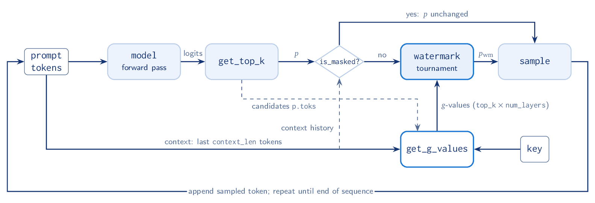
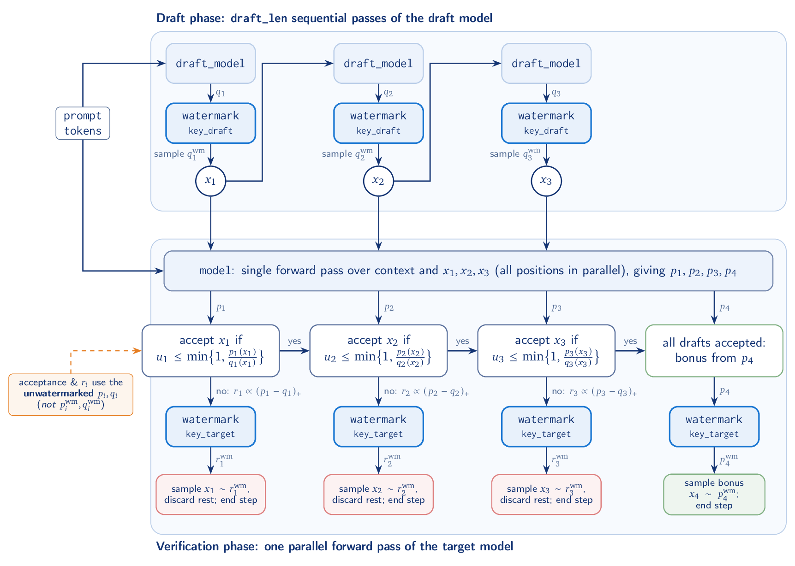

# SynthID Tournament Watermarking

**Tor Lattimore** (Google DeepMind) · Corresponding author: lattimore@google.com
· 2026-10-09

---

## Contents

1. [Introduction](#1-introduction)
2. [Tournament watermarking](#2-tournament-watermarking)
   - 2.1 [Speculative sampling](#21-speculative-sampling)
3. [Detection](#3-detection)
4. [Testing](#4-testing)
5. [Implementation tips and notes](#5-implementation-tips-and-notes)
6. [References](#6-references)

---

## 1. Introduction

<!-- disableFinding(LINK_RELATIVE_G3DOC) -->

**Scope.** This document provides pseudocode for tournament watermarking that is
suitable for implementation in production serving engines, including those using
speculative decoding. It is intended to accompany the open source implementation
in this repository (see the [README](../README.md)) to help users understand the
basic production-ready system at a higher level than the source code. Care has
been taken that all computations can be implemented with minimal latency cost on
both GPU and TPU, but we do not give specific details beyond a few suggestions
at the end. This document builds on the Nature paper [[1]](#ref-1), which offers
a range of alternatives, including distortionary methods that offer greater
detectability at the price of adding distortion.

In implementations without speculative decoding watermarking is added at the end
of every forward pass where it modifies the sampling procedure. At a very high
level, when sampling the $`t`$-th token the procedure uses pseudorandom numbers
(PRNs) derived from a secret key and the previous $`k`$ tokens (`context_len`).
Given access to the secret key, the PRNs used in the sampling can be recovered
and correlated with the observed tokens to identify the watermark.

**Glossary.** We use the following terms and constants.

| Name | Type | Description | Default |
|---|---|---|---|
| `context_history_size` | `int` | number of preceding contexts searched for a repeated context (see `is_masked`) | 1024 |
| `context_len` | `int` | number of preceding tokens ($`k`$) used to seed the PRNG | 4 |
| `ngram_len` | `int` | `context_len + 1`: a context together with the token that follows it (the name used in the code) | 5 |
| `top_k` | `int` | watermarking always samples from the `top_k` tokens | 40 |
| `depth` | `int` | number of tournament layers | 15 |
| `key` | `int` | secret key | |
| `key_draft`, `key_target` | `int` | secret keys when speculative decoding is enabled | |
| `draft_len` | `int` | number of draft proposals | |

## 2. Tournament watermarking

We start by explaining the basic version without speculative decoding where the
engine samples tokens autoregressively. The sampling engine in this case is
decomposed into four components:

- **`get_g_values`** — The PRNG that uses the context (previous `context_len`
  tokens) and the key to produce pseudorandom $`g`$-values for each candidate
  token.
- **`sampling_engine`** — The engine itself that autoregressively samples tokens
  from the model, injecting the watermark into the next-token distribution at
  the end of each forward pass.
- **`is_masked`** — A masking function that disables watermarking for early
  tokens and those with repeated context. This is essential for ensuring the
  watermarking procedure remains non-distortionary.
- **`watermark`** — The watermarking function that modifies the next-token
  distribution using the randomness.

We assume the following:

- **`distributions`** — A distribution `p` stores the token ids in its support
  `p.toks` and the associated probabilities `p.probs`. `copy(p)` returns an
  independent copy. `watermark` never modifies its argument; this matters in
  [Algorithm 5](#alg-speculative), where the unwatermarked distributions are
  still needed after their watermarked versions have been computed.
- **`model(prompt, tokens)`** — The forward pass of the algorithm mapping
  `prompt` and `tokens` to the distribution over the next token.
- **`get_top_k(p, top_k)`** — Restricts the distribution `p` to its `top_k` most
  probable tokens and renormalises the probabilities to sum to one. The result
  has exactly `top_k` entries, with `p.probs[j]` the probability of the token
  with id `p.toks[j]`. This means that row `j` of the $`g`$-value matrix
  returned by `get_g_values(context, p.toks, key)` is associated with token
  `p.toks[j]`. Watermarking is applied only after this truncation, so the
  watermarked distribution never places mass outside the top `top_k` tokens.
- **Aligned supports** — When two distributions are compared or subtracted
  (`p[i][token]` and `p[i] - q[i]` in [Algorithm 5](#alg-speculative)) they are
  implicitly aligned on the union of their supports, with tokens missing from
  one distribution given probability $`0`$; in particular a draft token outside
  the target's `top_k` is always rejected.
- **`hash(tokens, key)`** — A hash function mapping tokens and a key to
  pseudorandom integers.
- **`sample(p)`** — Samples a token from distribution `p`.
- **`context_appeared(context, history, context_history_size)`** — Returns
  `True` if `context` is one of the last `context_history_size` contexts of
  `history`, i.e. if it appears as a contiguous subsequence of
  `history[-(context_history_size + context_len - 1):]`. A vectorised
  implementation is given in [Section 5](#5-implementation-tips-and-notes).

The overall pipeline is illustrated in [Figure 1](#fig-pipeline).

<a id="fig-pipeline"></a>



**Figure 1.** Pipeline for autoregressive generation with tournament
watermarking (**without** speculative decoding). After each forward pass the
next-token distribution $`p`$, restricted to its `top_k` most probable tokens,
is either passed through unchanged (if `is_masked`) or reweighted by the
tournament using pseudorandom $`g`$-values derived from the secret key and the
preceding `context_len` tokens. The sampled token is appended and the loop
repeats. See [Algorithms 1](#alg-g) to [4](#alg-autoregressive).

<a id="alg-g"></a>

```python
def get_g_values(context, candidates, key):
  # context: the last context_len tokens
  # candidates: the tokens to compute g-values for (e.g. p.toks)
  # returns one row of depth {0,1} PRNs per candidate, where
  # row j depends only on (context, candidates[j], key)
  rows = []
  for tok in candidates:
    seed = hash(context + [tok], key)
    rng = np.random.default_rng(seed)
    rows.append(rng.integers(0, 2, size=depth))
  return np.array(rows)
```

**Algorithm 1.** PRNG from context and candidate tokens

<a id="alg-masking"></a>

```python
def is_masked(tokens):
  # watermarking will be disabled if the context is insufficient
  if len(tokens) < context_len:
    return True
  # watermarking will be disabled if the context is one of the previous context_history_size contexts.
  # The history excludes the final token so that the current context is not matched against itself,
  # but it does include earlier contexts that overlap the current one (e.g. in a run of repeated tokens).
  context = tokens[-context_len:]
  return context_appeared(context, tokens[:-1], context_history_size)
```

**Algorithm 2.** Masking function

<a id="alg-watermark"></a>

```python
def watermark(p, tokens, key):
  # do not watermark masked tokens
  if is_masked(tokens):
    return p
  context = tokens[-context_len:]
  g_values = get_g_values(context, p.toks, key)
  # copy so that p is unchanged: speculative sampling (Algorithm 5) still needs
  # the unwatermarked distributions after they have been watermarked
  p_wm = copy(p)
  for i in range(depth):
    g = g_values[:, i]
    g_mass = np.dot(g, p_wm.probs)
    # stays normalised: sum(p_wm.probs * (1 + g - g_mass)) = 1 + g_mass - g_mass = 1
    p_wm.probs = p_wm.probs * (1 + g - g_mass)
  return p_wm
```

**Algorithm 3.** Watermarking a distribution.

The last algorithm uses the previous helpers to watermark an autoregressive
generation.

<a id="alg-autoregressive"></a>

```python
def sampling_engine(prompt):
  tokens = []
  while not end_of_sequence(tokens):
    # run the forward pass to get the next-token distribution
    p = get_top_k(model(prompt, tokens), top_k)
    # watermark the distribution
    p_wm = watermark(p, tokens, key)
    # sample from the watermarked distribution
    token = sample(p_wm)

    tokens.append(token)
  return tokens
```

**Algorithm 4.** Autoregressive generation with tournament watermarking

Two remarks. First, `tokens` contains only the generated tokens, not the prompt:
the first `context_len` generated tokens are never watermarked and prompt
$`n`$-grams do not count towards `is_masked`. This is a deliberate choice that
keeps detection self-contained (the detector only needs the generated text), but
an implementation that also draws context from the prompt is equally valid
provided the detector has access to the prompt and does the same. Second,
non-distortion is relative to whatever distribution is passed to `watermark`, so
`watermark` must be the *last* transformation before `sample`: temperature, the
engine's own top-$`k`$/top-$`p`$ truncation, repetition penalties and so on must
all be applied before `get_top_k`, and nothing other than `sample` may be
applied after `watermark`.

### 2.1 Speculative sampling

Many serving engines use speculative sampling [[2]](#ref-2), [[3]](#ref-3),
which uses a small drafting model to accelerate sampling. A single step of
watermarked speculative sampling is illustrated in [Figure 2](#fig-speculative).
The naive approach is to watermark both the draft and target distributions using
the same key and run speculative decoding as normal. This is not recommended
because it reduces the acceptance rate (see
[Section 5](#5-implementation-tips-and-notes)). In contrast, the dual-key
approach described below ensures that watermarking does not change the
acceptance rate in expectation.

<a id="fig-speculative"></a>



**Figure 2.** A single step of speculative sampling with dual-key tournament
watermarking ([Algorithm 5](#alg-speculative)), shown for `draft_len` $`=3`$.
The draft model proposes tokens $`x_1, x_2, x_3`$ autoregressively, each sampled
from the draft distribution $`q_i`$ watermarked with `key_draft`. The target
model then scores all positions in a single forward pass, giving
$`p_1, \dots, p_4`$. Drafts are checked in order with
$`u_i \sim \mathcal U(0,1)`$, and the acceptance test compares the
*unwatermarked* distributions $`p_i`$ and $`q_i`$. At the first rejection,
$`x_i`$ is replaced by a sample from the residual distribution
$`r_i \propto \max(0, p_i - q_i)`$ watermarked with `key_target`, and the
remaining drafts are discarded. If all drafts are accepted, a *bonus* token (an
extra token, available at almost no cost from the same target forward pass) is
sampled from $`p_4`$ watermarked with `key_target`. Either way, each step
produces between $`1`$ and `draft_len` $`+\,1`$ tokens.

<a id="alg-speculative"></a>

```python
def step(prompt, tokens):
  for i in range(draft_len):
    q[i] = get_top_k(draft_model(prompt, tokens), top_k)
    q_wm[i] = watermark(q[i], tokens, key_draft)
    # sample the draft token from the watermarked distribution
    token = sample(q_wm[i])
    tokens.append(token)
  accepted_all = True
  for i in range(draft_len):
    token = tokens[i - draft_len]
    p[i] = get_top_k(model(prompt, tokens[:i - draft_len]), top_k)
    u = np.random.uniform(0, 1)
    # acceptance and residual use the unwatermarked p and q (not p_wm, q_wm)
    if u > min(1, p[i][token] / q[i][token]): # reject
      del tokens[i - draft_len:]
      # r has the same toks as p[i] with zero mass where p[i] <= q[i]; its total mass
      # is positive whenever rejection is possible (i.e. p[i] != q[i])
      r = normalise(max(0, p[i] - q[i]))
      r_wm = watermark(r, tokens, key_target)
      token = sample(r_wm)
      tokens.append(token)
      accepted_all = False
      break
  if accepted_all:
    # all drafts accepted: sample a bonus token
    p = get_top_k(model(prompt, tokens), top_k)
    p_wm = watermark(p, tokens, key_target)
    tokens.append(sample(p_wm))
```

**Algorithm 5.** Speculative sampling with dual-key tournament watermarking

The pseudocode writes the bonus distribution as a fresh call to `model`; in an
implementation it is the `draft_len + 1`-th output of the same target forward
pass that produced `p[0], ..., p[draft_len - 1]` (see
[Section 5](#5-implementation-tips-and-notes)).

<a id="alg-speculative-engine"></a>

```python
def speculative_sampling_engine(prompt):
  tokens = []
  while not end_of_sequence(tokens):
    step(prompt, tokens)
  return tokens
```

**Algorithm 6.** Autoregressive generation with tournament watermarking with
speculative decoding

## 3. Detection

The basic detector is straightforward:

<a id="alg-detect"></a>

```python
def frequentist_detector(tokens, key):
  count = 0
  num_unmasked = 0
  for i in range(len(tokens)):
    if not is_masked(tokens[:i]):
      context = tokens[i - context_len:i]
      g_values = get_g_values(context, [tokens[i]], key)
      count = count + np.sum(g_values)
      num_unmasked = num_unmasked + 1
  # p-value: P(X >= count) for X ~ Binomial(n, 1/2)
  n = num_unmasked * depth
  return binomial(n, 0.5).sf(count - 1)
```

**Algorithm 7.** Frequentist detector. Returns a $`p`$-value (close to zero
implies detection).

The detector should reproduce the generator's masking rule (including
`context_history_size`) exactly; this is what makes it score the tokens that
actually carry signal. Note, however, that masking never depends on the key, so
a mismatched mask (for example when the detector sees only a substring of the
generated text) only loses power and never inflates the false positive rate:
under the null the scored $`g`$-values remain i.i.d. $`\mathrm{Ber}(1/2)`$.

When speculative decoding is enabled, each generated token was sampled from a
distribution watermarked with one of the two keys: `key_draft` for accepted
drafts and `key_target` for resampled and bonus tokens. Which key was used is
not recorded in the text, so the detector computes the $`g`$-values under both
keys and aggregates them. For unwatermarked text the $`g`$-values under both
keys are independent $`\mathrm{Ber}(1/2)`$ random variables, so the count is
again binomial under the null, now with twice as many trials.

<a id="alg-detect-speculative"></a>

```python
def speculative_detector(tokens, key_draft, key_target):
  count = 0
  num_unmasked = 0
  for i in range(len(tokens)):
    if not is_masked(tokens[:i]):
      context = tokens[i - context_len:i]
      # score the token under both keys
      for key in [key_draft, key_target]:
        g_values = get_g_values(context, [tokens[i]], key)
        count = count + np.sum(g_values)
      num_unmasked = num_unmasked + 1
  # two keys per unmasked token, depth g-values per key. We use the same
  # depth for both keys, but this is not essential: with different depths
  # n = num_unmasked * (depth_draft + depth_target)
  n = 2 * num_unmasked * depth
  return binomial(n, 0.5).sf(count - 1)
```

**Algorithm 8.** Frequentist detector for speculative decoding with dual-key
watermarking. Returns a $`p`$-value (close to zero implies detection).

<!-- Single inline-math expressions below cannot be wrapped. -->
<!-- disableFinding(LINE_OVER_80) -->

## 4. Testing

The watermarking scheme is designed to be non-distortionary on the *record
level* (a record is a single generation) when the keys are randomised. This
means that if you sample `key` at random, then the distribution of the sampled
tokens is the same as without watermarking. Here "at random" means uniformly
from the key space of `hash` (e.g. 32-bit integers); all that is actually
required is that the $`g`$-values are i.i.d. $`\mathrm{Ber}(1/2)`$ over the draw
of the key. This is a consequence of the masking and the fact that the
`watermark` scheme is locally non-distortionary: masking ensures that no
context, and hence no set of $`g`$-values, is used twice within a record, so the
$`g`$-values at different positions are independent and local non-distortion
composes across positions. Strictly speaking this is only exact for records
shorter than roughly `context_history_size` tokens, since a context that recurs
more than `context_history_size` contexts later is not masked and its
$`g`$-values are reused. The resulting distortion is negligible in practice, but
it is the reason `context_history_size` should not be made small. To test this
we recommend the following tests:

- **Local non-distortion** — For any next-token distribution $`p`$ and unmasked
  `tokens`, averaging the watermarked distribution `watermark(p, tokens, key)`
  over random keys must recover $`p`$:
  $`\mathbb{E}_{\texttt{key}}[\texttt{watermark}(p, \texttt{tokens}, \texttt{key}).\texttt{probs}] = p.\texttt{probs}`$.
  See [Algorithm 9](#alg-test-distortion) for the basic sampler and
  [Algorithm 11](#alg-test-speculative) for a single step of speculative
  sampling with independent random `key_draft` and `key_target`.
- **Signal** — Watermarking reweights $`p`$ toward tokens with larger
  $`g`$-values, so for any non-degenerate $`p`$ the expected $`g`$-value of each
  layer under `watermark(p, context, key)` is strictly greater than $`1/2`$. For
  the first layer there is a closed form that holds under the *full* tournament:
  writing $`G_1 = \sum_x p(x) g_1(x)`$, the first layer maps $`p`$ to
  $`p(x)(1 + g_1(x) - G_1)`$, under which the expected $`g_1`$-value is
  $`2G_1 - G_1^2`$. Layers $`2, \dots,`$ `depth` are locally non-distortionary,
  so averaging over their keys returns the layer-1 output, and since the
  expected $`g_1`$-value is linear in the distribution this does not change it.
  Taking the expectation over $`g_1 \sim \mathrm{Ber}(1/2)`$ i.i.d. with $`p`$
  fixed gives
  $`\mathbb{E}_{\texttt{key}}\big[\sum_x p_{\mathrm{wm}}(x)\, g_1(x)\big] = \tfrac{1}{2} + \tfrac{1}{4}\big(1 - \sum_x p(x)^2\big)`$.
  For later layers the same argument gives
  $`\tfrac{1}{2} + \tfrac{1}{4}(1 - \sum_x p^{(i-1)}(x)^2)`$ where $`p^{(i-1)}`$
  is the (random) input to layer $`i`$; this has no closed form because
  $`\sum_x p^{(i-1)}(x)^2`$ is nonlinear, but it is strictly greater than
  $`1/2`$ and decreases with depth. [Algorithm 10](#alg-test-signal) checks the
  layer-1 value exactly and positivity for the remaining layers.
- **Global non-distortion** — You can test global non-distortion by selecting a
  wide range of metrics for a given generation. E.g., number of sampled tokens,
  distributions of $`n`$-grams. Then compare the distribution of these metrics
  without watermarking to the distribution with watermarking but with keys
  randomised on each generation.
- **Acceptance rate** — The watermarked speculative decoding is designed to have
  the same acceptance rate as the classical unwatermarked version. This should
  be tested; see [Algorithm 11](#alg-test-speculative).
- **Diversity** — Each tournament layer concentrates mass on tokens with
  favourable $`g`$-values, so for a fixed key the entropy of the watermarked
  distribution decreases with `depth`; with very many layers the watermarked
  model is close to deterministic for a fixed key, which is undesirable for many
  applications. Dual-key speculative decoding mitigates this: accepted drafts
  are watermarked under `key_draft` and resampled/bonus tokens under
  `key_target`, so the generated sequence is a mixture over two independent
  tournaments and is typically more diverse than single-key autoregressive
  sampling with the same `depth`. This should be measured with the same metrics
  as the global non-distortion test.
- **Evaluations** — Once the implementation is solid, you should perform
  evaluations *with the production keys*. The theoretical guarantees of the
  watermarking procedure are all with respect to random keys. If the g-values
  associated with a frequently occurring $`n`$-gram are particularly
  disadvantageous, then watermarking can reduce quality. This must be tested
  with a full suite of downstream evaluations.
- **Controlled FPR** — Run the detector with the wrong key to check that the
  false positive rate is controlled, and be precise about what is guaranteed.
  Write $`\mathrm{detect}(x, \texttt{key})`$ for the $`p`$-value returned by the
  detector and, for a distribution $`\xi`$ over unwatermarked texts, let
  $`\mathrm{FPR}(\xi, \texttt{key}, \alpha) = \mathbb{P}_{x \sim \xi}\big(\mathrm{detect}(x, \texttt{key}) < \alpha\big)`$
  be the false positive rate at level $`\alpha`$ for a *fixed* key. The binomial
  null is a statement about the draw of the key: for every fixed text $`x`$,
  $`\mathbb{P}_{\texttt{key}}(\mathrm{detect}(x, \texttt{key}) < \alpha) \le \alpha`$.
  Averaging over $`x \sim \xi`$ gives
  $`\mathbb{E}_{\texttt{key}}[\mathrm{FPR}(\xi, \texttt{key}, \alpha)] \le \alpha`$,
  but nothing more: for the one key you actually deploy,
  $`\mathrm{FPR}(\xi, \texttt{key}, \alpha)`$ is a random variable with mean at
  most $`\alpha`$, and
  $`\mathbb{P}_{\texttt{key}}(\mathrm{FPR}(\xi, \texttt{key}, \alpha) > \alpha)`$
  can be large. The extreme case is $`\xi`$ a point mass on a single text, where
  $`\mathrm{FPR} \in \{0, 1\}`$ and equals $`1`$ with probability up to
  $`\alpha`$. The mechanism for realistic $`\xi`$ is shared $`n`$-grams: for a
  fixed key every text containing the same (`context_len` $`+ 1`$)-gram sees the
  same $`g`$-values, so if the production key happens to assign high
  $`g`$-values to common $`n`$-grams then the FPR is inflated for all texts
  simultaneously. The more diverse $`\xi`$ is, the more tightly
  $`\mathrm{FPR}(\xi, \texttt{key}, \alpha)`$ concentrates around its mean,
  which is why in practice we never observe a problem, but you should
  nevertheless calibrate on unwatermarked data with the production keys rather
  than rely on the nominal $`p`$-value alone.

<a id="alg-test-distortion"></a>

```python
def test_local_non_distortion():
  context = list(range(context_len))
  for i in range(n_dists):
    p = sample_distribution()
    p_hat = np.zeros(top_k)
    for j in range(n_keys):
      key = np.random.randint(0, 1e8)
      p_wm = watermark(p, context, key)
      p_hat += p_wm.probs / n_keys
    assert np.max(np.abs(p.probs - p_hat)) < tol
```

**Algorithm 9.** Test local non-distortion

<a id="alg-test-signal"></a>

```python
def test_signal():
  context = range(context_len)
  for i in range(n_dists):
    p = sample_distribution()  # must have non-trivial entropy: 1 - sum(p.probs**2) >> tol
    # n_keys must be large enough that the Monte Carlo error ~ 0.5 / sqrt(n_keys)
    # is well below tol and below the per-layer signal
    g_hat = np.zeros(depth)
    for j in range(n_keys):
      key = np.random.randint(0, 1e8)
      p_wm = watermark(p, context, key)
      g_values = get_g_values(context, p.toks, key)
      # expected g-value of each layer under the watermarked distribution
      g_hat += np.dot(p_wm.probs, g_values) / n_keys
    # layer 1 has a closed form under the full tournament
    assert abs(g_hat[0] - (0.5 + (1 - np.sum(p.probs**2)) / 4)) < tol
    # every later layer carries strictly positive (but decreasing) signal
    assert np.all(g_hat[1:] > 0.5)
```

**Algorithm 10.** Test watermark signal

<a id="alg-test-speculative"></a>

```python
def test_speculative_local_non_distortion():
  context = range(context_len)
  for i in range(n_dists):
    p = sample_distribution()
    q = sample_distribution() # on the same support as p
    r = normalise(max(0, p - q))
    acc_prob = np.minimum(1, p.probs / q.probs)
    target_acc = np.dot(q.probs, acc_prob)
    acc_hat = 0.0
    p_hat = np.zeros(top_k)
    for j in range(n_keys):
      key_draft = np.random.randint(0, 1e8)
      key_target = np.random.randint(0, 1e8)
      q_wm = watermark(q, context, key_draft)
      r_wm = watermark(r, context, key_target)
      acc = np.dot(q_wm.probs, acc_prob)
      acc_hat += acc / n_keys
      p_hat += (q_wm.probs * acc_prob + (1 - acc) * r_wm.probs) / n_keys
    assert abs(acc_hat - target_acc) < tol
    assert np.max(np.abs(p.probs - p_hat)) < tol
```

**Algorithm 11.** Test local non-distortion and acceptance rate for speculative
sampling

## 5. Implementation tips and notes

- The context history covers the last `context_history_size + context_len - 1`
  tokens, which hold exactly `context_history_size` contexts, and can be stored
  in a ring buffer of that length. The lookup in `context_appeared` can be
  written as a loop over the history, or fully vectorised with static shapes,
  which also lets it compile under `jax.jit` (with `np` replaced by
  `jax.numpy`): keep `history` left-padded with an invalid token id (e.g. `-1`)
  to length `context_history_size + context_len - 1`, gather every contiguous
  window of length `context_len`, and compare them all to `context` at once.
  Padded windows can never match because `-1` is not a valid token id.

  ```python
  def context_appeared(context, history, context_history_size):
    # context: int array of shape (context_len,), the last context_len tokens
    # history: int array of shape (context_history_size + context_len - 1,), the preceding
    #          tokens (most recent last), left-padded with -1 when fewer are available
    n = context_history_size  # number of contexts in history
    idx = np.arange(n)[:, None] + np.arange(context_len)[None, :]  # (n, context_len)
    windows = history[idx]                                         # every contiguous window
    return np.any(np.all(windows == context, axis=1))
  ```

  If `history` is a ring buffer, unroll it with `np.roll` before the gather (or
  precompute `idx` modulo the buffer length).
- Be careful to update the context history when draft tokens are rejected.
  Whatever data structure you use for storing the context history, you need to
  be able to delete in LIFO order.
- There is an alternative version of speculative decoding where both the target
  and draft distributions are watermarked with the same key. A token is accepted
  if $`u < \min(1, p_{wm}(x) / q_{wm}(x))`$ and the residual is
  $`r \propto \max(0, p_{wm} - q_{wm})`$. This version has the advantage that
  you can use the single key detector and the detection signal is stronger. On
  the downside, the speculative sampling rate drops: for a fixed key the
  acceptance probability is $`\sum_x \min(p_{wm}(x), q_{wm}(x))`$ and, since
  $`\min`$ is concave, Jensen's inequality gives
  $`\mathbb{E}_{\text{key}} \sum_x \min(p_{wm}(x), q_{wm}(x)) \le \sum_x \min(\mathbb{E}\, p_{wm}(x), \mathbb{E}\, q_{wm}(x)) = \sum_x \min(p(x), q(x))`$,
  with strict inequality whenever watermarking is not a no-op. Hence this
  exchanges throughput for detectability.
- You should experiment with the number of draft and target layers. The Bayesian
  detector (see the Nature paper [[1]](#ref-1) and the
  [Colab notebook](https://colab.research.google.com/github/google-deepmind/synthid-text/blob/main/notebooks/synthid_text_huggingface_integration.ipynb))
  offers stronger detection performance.
- When implementing speculative decoding, the draft distributions need to be
  computed and watermarked sequentially. Once the target distributions have been
  computed (in a single pass), the residuals and the bonus distribution can be
  watermarked in parallel.

## 6. References

1. <a id="ref-1"></a>Dathathri, S., See, A., Ghaisas, S., Huang, P.-S., McAdam,
   R., Welbl, J., Bachani, V., Kaskasoli, A., Stanforth, R., Matejovicova, T.,
   Hayes, J., Vyas, N., Merey, M. A., Brown-Cohen, J., Bunel, R., Balle, B.,
   Cemgil, T., Ahmed, Z., Stacpoole, K., Shumailov, I., Baetu, C., Gowal, S.,
   Hassabis, D., and Kohli, P. *Scalable watermarking for identifying large
   language model outputs.* Nature **634**, 818–823 (2024).
   [doi:10.1038/s41586-024-08025-4](https://doi.org/10.1038/s41586-024-08025-4)
2. <a id="ref-2"></a>Leviathan, Y., Kalman, M., and Matias, Y. *Fast inference
   from transformers via speculative decoding.* ICML (2023).
   [arXiv:2211.17192](https://arxiv.org/abs/2211.17192)
3. <a id="ref-3"></a>Chen, C., Borgeaud, S., Irving, G., Lespiau, J.-B., Sifre,
   L., and Jumper, J. *Accelerating large language model decoding with
   speculative sampling.* [arXiv:2302.01318](https://arxiv.org/abs/2302.01318)
   (2023).
